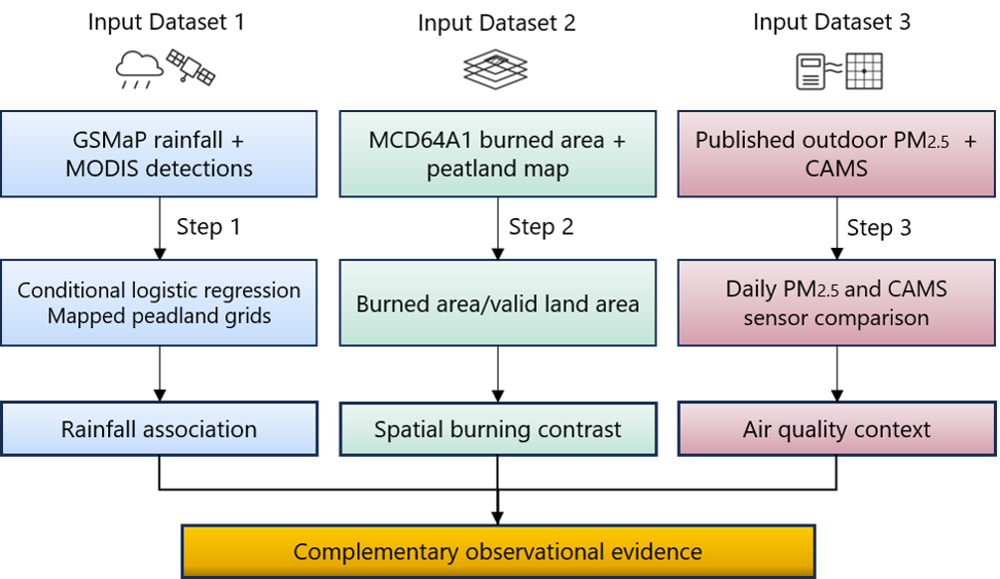

# Supplementary results

This supplement accompanies the consistency-checked analysis release of 5 October 2026. The 8 October supplementary update adds the observational workflow as Figure S1 and the rainfall-category counts as Table S10. The two previously supplied supplementary figures are renumbered S2 and S3 without changing their content.

## Observational analysis workflow

Figure S1. Overview of the observational analysis workflow. Rainfall and MODIS records were used to examine antecedent rainfall associations during 2020–2025. Burned-area observations were compared within and outside mapped peatland in Central Kalimantan during August–November 2023. Published outdoor PM₂.₅ measurements and atmospheric reanalysis provided supporting air-quality context.

## MODIS spatial and record checks

Table S1 provides complete province-by-year counts, with zero classes retained. Table S2 describes recorded detections by satellite, day/night, confidence, footprint, and processing source. These describe detections; they do not measure clear-sky observation availability.

## Rainfall model and observation sensitivities

Table S3 contains every term for all 14 model specifications. The principal dry-versus-wet contrast is summarized below. Table S4 and Figure S2 isolate observation-subset checks. Each contrast compares 0–10 with >100 mm of preceding seven-day rainfall, adjusts for earlier rainfall, and conditions on cell × year-month. Intervals use the same covariance and t convention throughout.

| Specification | Odds ratio | Approximate 95% interval | Informative strata |
| --- | --- | --- | --- |
| Primary full year | 10.50 | 6.78–16.27 | 1420 |
| Matched January–26 September | 14.98 | 8.45–26.57 | 1062 |
| July–November | 10.51 | 5.82–18.98 | 980 |
| Excluding 2023 | 11.72 | 6.60–20.79 | 812 |
| All thermal anomalies | 10.41 | 6.80–15.95 | 1424 |
| High confidence, all types | 13.98 | 6.83–28.62 | 415 |
| High confidence, vegetation type | 13.98 | 6.83–28.62 | 415 |
| Terra only | 15.37 | 8.11–29.13 | 632 |
| Aqua only | 8.99 | 5.44–14.86 | 1190 |
| Daytime only | 8.94 | 5.59–14.31 | 1352 |
| Nighttime only | 22.71 | 9.23–55.87 | 367 |
| Scan and track ≤1.5 km | 9.55 | 6.24–14.62 | 1165 |
| Cell centre in ID 6 | 9.03 | 5.67–14.39 | 781 |
| At least 25% sampled peat | 10.74 | 6.95–16.60 | 1142 |

Odds ratios from different detection subsets need not have equal magnitudes: the subsets observe different acquisition times and fire characteristics. Consistent direction does not establish that cloud bias is absent.

## Rainfall category counts

Table S10. Distribution of analytic grid-days and recorded vegetation-fire detection grid-days across preceding seven-day rainfall categories, 2020–2025.

| Preceding seven-day rainfall (mm) | Grid-days in the complete analytic panel | Grid-days in informative strata | Recorded detection grid-days in informative strata |
| --- | ---: | ---: | ---: |
| 0–10 | 136,716 | 9,974 | 1,498 |
| >10–30 | 272,585 | 9,244 | 758 |
| >30–60 | 500,096 | 11,413 | 499 |
| >60–100 | 460,728 | 8,023 | 214 |
| >100 | 324,291 | 4,629 | 90 |
| Total | 1,694,416 | 43,283 | 3,059 |

Informative strata contained both detection and non-detection grid-days within the same grid cell and year-month. Counts describe the observations available to the analysis and should not be interpreted as population-wide fire probabilities.

## Burned area

Table S5 supplies monthly burned fractions with month-specific valid-area denominators. Table S6 reports the seasonal QA alternatives, with all four months required valid. The seasonal primary contrast is 3.411, the shortened-mapping exclusion gives 3.294, and the special-unburned-flag exclusion gives 3.393. The previously computed any-intersection boundary alternative gives 3.60; it was not rerun in this pass. These are sensitivity scenarios, not confidence limits.

## Published sensor and CAMS comparisons

Tables S7–S8 and Figure S3 use the verified processed daily sensor data and raw-CAMS rerun outputs. October means are 171.2 µg/m³ across reporting sites, 156.4 for fixed sites PLK_01/SBG_01, and 171.9 excluding KR_06. CAMS UTC/WIB means are 187.8/187.9 µg/m³ versus 96.9 at sensors over 107 paired days. Level correlations are 0.882/0.881 and first-difference correlations 0.383/0.204. The sensor daily averaging window remains unspecified. Date-offset checks and raw-source verification are retained in evidence/.

## Working Poisson sensitivity

Table S9 retains the earlier linear mean-model comparison. Its matched-window seven-day IRR is 0.316 (0.261–0.382), while the full-year IRR is 0.338 (0.287–0.397). These are not the primary categorical odds ratios and should not replace Table 2 or Figure 3.

## Sources and limits

Published sensor data: Graham et al. (2024), DOI 10.5281/zenodo.13767528; source article DOI 10.1029/2024GH001125. CAMS: ECMWF (2020), DOI 10.24381/d58bbf47. NASA fire and burned-area documentation and BIG source endpoints are cited in the main manuscript and audit report. Outside ID 6 is not verified mineral soil. No peat-specific emissions, smoke-source contributions, health burden, or prospective forecasting performance are estimated.
